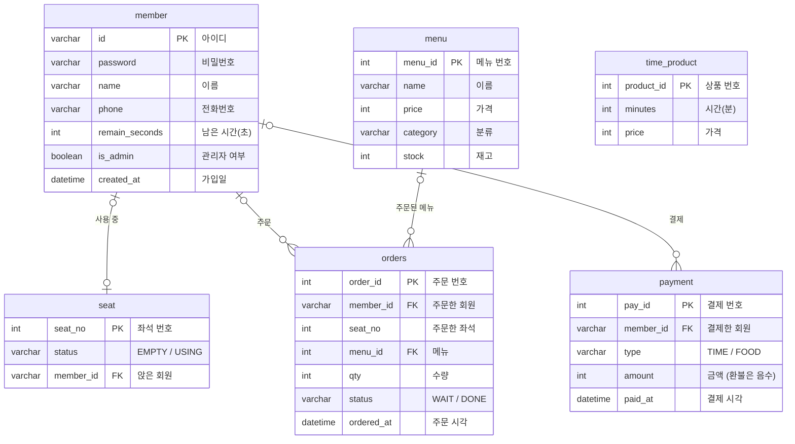

# DB 설계

관리자 계정은 `member.is_admin = TRUE`로 구분한다.

## E-R 다이어그램



**관계 읽는 법**

| 관계 | 뜻 |
| --- | --- |
| member — seat (0..1 : 0..1) | 좌석에는 회원이 없거나 1명. 회원은 좌석에 앉아 있지 않거나 1자리 (1자리 제한은 앱에서 검사) |
| member — orders (0..1 : 0..N) | 회원 1명이 주문 여러 개. 회원이 삭제되면 주문의 `member_id`는 NULL (기록은 남음) |
| menu — orders (0..1 : 0..N) | 메뉴 1개가 여러 주문에 들어감. 메뉴가 삭제되면 `menu_id`는 NULL |
| member — payment (0..1 : 0..N) | 회원 1명이 결제 여러 번 |

- 모든 외래키는 `ON DELETE SET NULL`: 회원이나 메뉴를 지워도 주문·결제 기록은 남아서 매출이 안 바뀐다.
- `orders.seat_no`는 외래키가 아니다. 주문 당시 좌석 번호를 기록으로만 남긴다.
- `time_product`는 다른 테이블과 연결이 없는 요금표다. 시간을 구매하면 `payment`에 금액만 기록된다.

## 테이블

```sql
CREATE TABLE member (
    id             VARCHAR(20) PRIMARY KEY,
    password       VARCHAR(64) NOT NULL,
    name           VARCHAR(20) NOT NULL,
    phone          VARCHAR(20),
    remain_seconds INT NOT NULL DEFAULT 0,
    is_admin       BOOLEAN NOT NULL DEFAULT FALSE,
    created_at     DATETIME DEFAULT CURRENT_TIMESTAMP
);

CREATE TABLE seat (
    seat_no   INT PRIMARY KEY,
    status    VARCHAR(10) NOT NULL DEFAULT 'EMPTY',   -- EMPTY / USING
    member_id VARCHAR(20) NULL,
    FOREIGN KEY (member_id) REFERENCES member(id) ON DELETE SET NULL
);

CREATE TABLE time_product (
    product_id INT AUTO_INCREMENT PRIMARY KEY,
    minutes    INT NOT NULL,
    price      INT NOT NULL
);

CREATE TABLE menu (
    menu_id  INT AUTO_INCREMENT PRIMARY KEY,
    name     VARCHAR(30) NOT NULL,
    price    INT NOT NULL,
    category VARCHAR(20),
    stock    INT NOT NULL DEFAULT 0
);

CREATE TABLE orders (
    order_id   INT AUTO_INCREMENT PRIMARY KEY,
    member_id  VARCHAR(20),
    seat_no    INT,
    menu_id    INT,
    qty        INT NOT NULL DEFAULT 1,
    status     VARCHAR(10) NOT NULL DEFAULT 'WAIT',   -- WAIT / DONE
    ordered_at DATETIME DEFAULT CURRENT_TIMESTAMP,
    FOREIGN KEY (member_id) REFERENCES member(id) ON DELETE SET NULL,
    FOREIGN KEY (menu_id)   REFERENCES menu(menu_id) ON DELETE SET NULL
);

CREATE TABLE payment (
    pay_id    INT AUTO_INCREMENT PRIMARY KEY,
    member_id VARCHAR(20),
    type      VARCHAR(10) NOT NULL,                   -- TIME / FOOD
    amount    INT NOT NULL,
    paid_at   DATETIME DEFAULT CURRENT_TIMESTAMP,
    FOREIGN KEY (member_id) REFERENCES member(id) ON DELETE SET NULL
);
```

## CRUD 매핑

| 테이블 | Create | Read | Update | Delete |
| --- | --- | --- | --- | --- |
| member | 회원가입 | 로그인, 회원 목록 | 정보 수정, 남은 시간 저장 | 회원 삭제 |
| seat | 초기 데이터 | 좌석판 | 사용 시작 / 종료, 자리 이동 | - |
| menu | 메뉴 추가 | 메뉴 목록 | 메뉴 수정, 재고 | 메뉴 삭제 |
| orders | 음식 주문 | 주문 목록 | 상태 변경 | 주문 취소 |
| payment | 시간 구매, 주문 결제 | 매출 확인 | - | - |
| time_product | 초기 데이터 | 요금표 | - | - |

관련: [[기능 명세]] · [[패키지 구조]]
