# PC방 관리 프로그램 기획서

Java Swing + MySQL로 만드는 PC방 관리 프로그램입니다.
한 JVM 안에서 **관리자 창 1개**와 **게스트 창 N개**를 띄우고, 게스트 창은 관리자 화면의 버튼으로 계속 생성할 수 있습니다.

## 1. 개요

| 항목 | 내용 |
| --- | --- |
| 언어 / UI | Java, Swing (JFrame 상속 구조) |
| DB | MySQL, JDBC (MySQL Connector/J) |
| 실행 형태 | 한 JVM, 관리자 창 1 + 게스트 창 N |
| 핵심 기술 | 상속, 스레드, 이벤트 처리, DB CRUD |
| 채팅 | 객체 참조로 실시간 전달 + DB(`chat_message`)에 저장 |
| 결제 | 메뉴 표 + 주문 목록, 결제 수단(카드/현금/포인트), 결제 상세, 트랜잭션 |

## 2. 시스템 구조

```
                 BaseFrame (abstract, extends JFrame)
                 ├─ 공통 레이아웃 / 폰트 / 창 크기
                 └─ initUI() 추상 메서드
                        ▲                    ▲
                        │ 상속               │ 상속
                  AdminFrame             GuestFrame  ×N (new 로 계속 생성)
                  - guests 목록 관리      - 로그인 / 회원가입
                  - 좌석판 표시           - 좌석 선택
                  - "게스트 추가" 버튼 ──▶ - TimerThread 1개씩 보유
                        │   ▲                    │
                        │   └── 채팅 / 시간 갱신 콜백 ┘
                        ▼
                    DAO 계층 ──▶ MySQL
```

- **상속**: `BaseFrame`을 `AdminFrame`, `GuestFrame`이 상속한다. (`LoginDialog` 등도 공통 부모를 두면 좋음)
- **게스트 창 생성**: 관리자 화면의 "게스트 추가" 버튼을 누를 때마다 `new GuestFrame(this)` 실행 → 인스턴스 다중 생성
- **창 닫기 설정**
  - `AdminFrame`: `EXIT_ON_CLOSE` (프로그램 전체 종료)
  - `GuestFrame`: `DISPOSE_ON_CLOSE` (자기 창만 닫힘)
- 관리자는 `List<GuestFrame>`으로 모든 게스트 창을 알고, 게스트는 생성자로 받은 `AdminFrame` 참조를 가진다.

## 3. 기능 명세

### 3-1. 게스트 창

| 기능 | 설명 | 우선순위 |
| --- | --- | --- |
| 회원가입 | 아이디 중복 체크 후 DB 저장. 비밀번호 찾기 질문(4개 중 선택)과 답변 필수 | 필수 |
| 아이디 찾기 | 이름 + 전화번호로 아이디 조회 ('-' 유무 무관, 관리자 제외) | 중요 |
| 비밀번호 찾기 | 아이디 → 질문 확인 → 답변이 맞으면 새 비밀번호로 변경 | 중요 |
| 로그인 | DB 조회, 같은 계정 중복 로그인 차단 | 필수 |
| 좌석 선택 | 빈 좌석만 표시. 콤보박스를 펼칠 때마다 DB에서 다시 읽음 | 필수 |
| 남은 시간 표시 | 1초마다 감소, 화면 갱신 | 필수 |
| 시간 추가 구매 | 요금제 선택 → 결제 수단 입력 → 시간 추가 + 결제·결제 상세 저장 | 필수 |
| 사용 종료 / 창 닫기 | 남은 시간 DB 저장, 좌석 비우기, 스레드 종료 | 필수 |
| 관리자와 채팅 | 메시지 송수신, DB 저장. 로그인하면 이전 대화를 불러옴 | 중요 |
| 음식 주문 | 전체 메뉴 표(메뉴·분류·가격·재고)에서 골라 주문 목록에 담기 → 결제 수단 입력 → 관리자에게 알림 | 중요 |
| 포인트 | 카드·현금 결제액의 5% 적립, 결제할 때 사용 | 중요 |
| 5분 남음 경고 | 5분 이하로 처음 내려가면 팝업 (관리자가 -10분 해도 뜸) | 선택 |
| 시간 0 → 자동 종료 | 자동 로그아웃 | 필수 |

### 3-2. 관리자 창

| 기능 | 설명 | 우선순위 |
| --- | --- | --- |
| 게스트 추가 버튼 | 새 `GuestFrame` 인스턴스 생성 | 필수 |
| 좌석판 | 좌석 그리드, 빈자리/사용중 색 구분, 사용자·남은 시간 실시간 표시 | 필수 |
| 총 좌석 수 | 숫자를 입력해 한 번에 맞춤. 늘리면 마지막 번호 뒤로 추가, 줄이면 번호가 큰 빈 좌석부터 삭제 (사용 중 좌석은 유지) | 중요 |
| 좌석 추가 / 삭제 | 1석씩 추가, 선택한 빈 좌석 삭제. 사용 중인 좌석은 삭제 불가 | 중요 |
| 손님 시간 추가 / 차감 | 선택한 좌석의 남은 시간 변경 | 필수 |
| 강제 종료 | 선택한 좌석 사용 종료 (시간 저장 후 로그아웃) | 필수 |
| 회원 관리 | 검색 기준(이름 / 전화번호 뒤 4자리 / 아이디)으로 조회, 수정, 삭제 | 필수 |
| 메뉴 관리 | 신규 메뉴 등록 / 정보 수정 / 재고 입고 / 삭제 | 중요 |
| 요금제 관리 | 시간 요금제 등록 / 수정 / 삭제 | 중요 |
| 주문 확인 | 주문 목록(품목, 결제 금액), 완료 처리, 취소(환불) | 중요 |
| 게스트와 채팅 | 좌석을 고르면 그 손님과의 이전 대화를 불러옴 | 중요 |
| 매출 확인 | 오늘 시간 / 음식 매출, 결제 수단별 합계 | 선택 |

> 사용 중에 시간을 더 사면(연장) 좌석은 그대로 두고 남은 시간만 늘어난다. 타이머 스레드도 계속 돈다.
> 로그인할 때 남은 시간이 0이면 바로 시간 구매 창이 뜨고, 사지 않으면 사용을 끝낸다.

## 4. 스레드 설계

- 게스트 1명 = `TimerThread` 1개. 로그인하고 좌석을 선택하면 시작한다.
- 1초마다 `remainSeconds--` → 게스트 화면과 관리자 좌석판 갱신
- Swing 화면 갱신은 반드시 `SwingUtilities.invokeLater(...)` 안에서 처리
- 관리자의 시간 추가/차감과 타이머 감소가 동시에 일어나므로 시간 변경 메서드는 `synchronized`
- `synchronized`를 쓰는 곳은 세 군데다.

  | 대상 | 동시에 접근하는 쪽 | 방법 |
  | --- | --- | --- |
  | 남은 시간 (`GuestFrame`) | 타이머 스레드 ↔ 관리자 시간 ±10분, 시간 구매 | `synchronized` 메서드 |
  | 좌석 상태 (`SeatDAO`) | 여러 게스트 창의 사용 시작, 좌석 추가/삭제 | `static` 자물쇠 `LOCK`에 `synchronized` 블록 |
  | 결제 트랜잭션 (`PaymentService`) | 여러 게스트 창의 주문·시간 구매 ↔ 관리자의 주문 취소 | `static` 자물쇠 `LOCK`에 `synchronized` 블록 |

  게스트 창마다 DAO와 서비스 객체를 따로 만들기 때문에, 인스턴스 메서드에 `synchronized`를 붙이면 창마다 다른 자물쇠를 잡아서 효과가 없다. 그래서 모두가 함께 쓰는 `static` 자물쇠를 둔다.
- **DB 저장 시점**
  1. 게스트 창 닫기 (`windowClosed`)
  2. 사용 종료 / 강제 종료
  3. 1분마다 자동 저장 (비정상 종료 대비)
- 종료할 때는 `interrupt()`로 스레드를 멈추고, `InterruptedException`에서 루프를 빠져나온다.
- 남은 시간이 0이 되면 자동 종료, 300초(5분) 이하로 처음 내려가면 경고 팝업

```java
public class TimerThread extends Thread {
    private final GuestFrame guest;

    @Override
    public void run() {
        int tick = 0;
        try {
            while (guest.getRemainSeconds() > 0) {
                Thread.sleep(1000);
                guest.decreaseOneSecond();          // synchronized
                if (++tick % 60 == 0) guest.saveRemainTime();
            }
            SwingUtilities.invokeLater(guest::forceLogout);
        } catch (InterruptedException e) {
            // 정상 종료
        }
    }
}
```

## 5. 채팅 설계

- 한 JVM이라 소켓 없이 **객체 참조로 메서드를 직접 호출**한다.
- 게스트 → 관리자: `admin.receiveMessage(seatNo, name, msg)`
- 관리자 → 게스트: `guestFrame.receiveMessage(msg)` (`guests` 목록에서 좌석 번호로 찾음)
- 보내는 쪽이 `ChatDAO.insert()`로 `chat_message`에 저장한 뒤 상대 창에 전달한다.
- 게스트는 로그인할 때, 관리자는 사용 중인 좌석을 고를 때 그 손님과의 최근 대화 50개를 DB에서 불러온다.

## 6. DB 설계

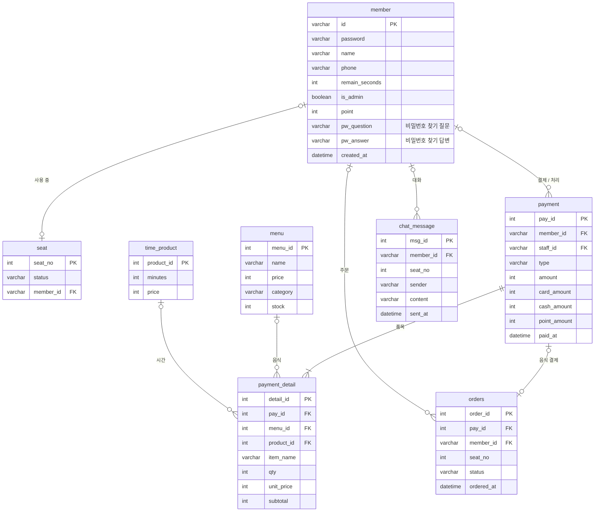

- 외래키는 `ON DELETE SET NULL`이라 회원·메뉴·요금제를 지워도 결제 기록(매출)은 남는다. `payment_detail.pay_id`만 `CASCADE`다.
- `payment.staff_id`는 처리한 관리자다. 손님이 직접 결제하면 `NULL`, 관리자가 주문을 취소(환불)하면 그 관리자 아이디가 들어간다.
- `orders.seat_no`, `chat_message.seat_no`는 외래키가 아닌 기록용 값이다. 좌석을 삭제해도 기록은 남는다.
- 전체 SQL과 초기 데이터는 [`sql/schema.sql`](sql/schema.sql)에 있다.

### orders와 payment를 왜 나누나

| 테이블 | 무엇을 기록하나 | 언제 들어가나 |
| --- | --- | --- |
| `payment` | **돈의 흐름**: 누가, 얼마를, 어떤 수단으로 냈는지 | 시간 구매, 음식 결제, 주문 취소(음수 환불) |
| `payment_detail` | **영수증 품목**: 무엇을 몇 개, 그때 단가 얼마에 샀는지 | `payment`와 같은 트랜잭션에서 품목마다 한 행 |
| `orders` | **주방 처리 상태**: 대기 → 완료 / 취소 | 음식 결제와 같은 트랜잭션에서 한 행 (시간 구매는 주문이 없다) |

- 시간 구매는 돈만 오가고 처리할 일이 없어서 `payment`만 생긴다. 음식은 결제 후에 조리·전달을 처리해야 해서 `orders`가 따로 있다.
- `orders.pay_id`로 둘을 연결한다. 주문 목록의 품목과 금액은 `payment_detail`, `payment`에서 가져오므로, 메뉴 가격을 나중에 바꿔도 과거 주문 금액과 환불액은 바뀌지 않는다.
- 음식 주문은 재고 차감 → `payment` → `payment_detail` → `orders` → 포인트 적립을 **한 트랜잭션**(`PaymentService`)으로 처리한다. 하나라도 실패하면(재고·포인트 부족) `rollback` 해서 아무것도 남지 않는다.
- 주문 취소도 한 트랜잭션이다: `orders.status = CANCEL` → 원 결제를 음수로 복사한 환불 결제와 상세 → 재고 복구 → 쓴 포인트 반환, 적립 포인트 회수.

### CRUD 매핑

| 테이블 | Create | Read | Update | Delete |
| --- | --- | --- | --- | --- |
| member | 회원가입 | 로그인, 회원 검색, 아이디 찾기, 비밀번호 찾기 질문 | 정보 수정, 남은 시간 저장, 포인트, 비밀번호 재설정 | 회원 삭제 |
| seat | 좌석 추가, 총 좌석 수 늘리기 | 좌석판, 빈 좌석 목록 | 사용 시작 / 종료 | 좌석 삭제, 총 좌석 수 줄이기 (빈 좌석만) |
| time_product | 요금제 등록 | 요금제 목록 | 요금제 수정 | 요금제 삭제 |
| menu | 메뉴 등록 | 메뉴 목록 | 정보 수정, 재고 입고 / 차감 | 메뉴 삭제 |
| payment | 시간 구매, 음식 결제, 환불 | 매출 확인 | - | - |
| payment_detail | 결제와 함께 저장 | 주문 목록 품목, 환불 | - | (결제 삭제 시 CASCADE) |
| orders | 음식 결제 | 주문 목록 | 완료 / 취소 | - |
| chat_message | 메시지 보내기 | 이전 대화 불러오기 | - | - |

관리자 계정은 `member.is_admin = TRUE`로 구분한다.

`pw_question`과 `pw_answer`는 함께 있거나 함께 없다 (`CHECK` 제약). 새 회원은 가입할 때 반드시 입력하고, 관리자와 예전 회원은 `NULL`이라 비밀번호 찾기를 쓸 수 없다 (관리자에게 문의).

## 7. 패키지 / 클래스 구조

```
pom.xml                          // Maven (mysql-connector-j)
sql/
├─ schema.sql                    // 테이블 생성 + 초기 데이터 (새로 설치할 때)
├─ migrate_v2.sql                // 예전 구조의 DB를 데이터 유지한 채 새 구조로
└─ migrate_v3.sql                // 비밀번호 찾기 질문·답변 컬럼 추가 (v2 다음에)
src/main/resources/
└─ db.properties.example         // 복사해서 db.properties로 사용 (git 제외)
src/main/java/pccafe/
├─ Main.java                     // 관리자 로그인 창 실행
├─ db/
│  └─ DBUtil.java                // Connection 관리
├─ dto/
│  ├─ Member.java
│  ├─ Seat.java
│  ├─ Menu.java
│  ├─ TimeProduct.java
│  ├─ Payment.java               // 결제 (카드/현금/포인트 금액)
│  ├─ PaymentDetail.java         // 결제 상세 (영수증 한 줄)
│  ├─ Order.java
│  └─ ChatMessage.java
├─ dao/
│  ├─ MemberDAO.java
│  ├─ SeatDAO.java
│  ├─ MenuDAO.java
│  ├─ TimeProductDAO.java
│  ├─ PaymentDAO.java
│  ├─ PaymentDetailDAO.java
│  ├─ OrderDAO.java
│  └─ ChatDAO.java
├─ service/
│  ├─ PaymentService.java        // 음식 주문 / 시간 구매 / 주문 취소 트랜잭션
│  └─ PaymentException.java      // 재고·포인트 부족 등
├─ ui/
│  ├─ BaseFrame.java             // abstract, extends JFrame
│  ├─ AdminLoginFrame.java       // extends BaseFrame, 시작 화면
│  ├─ AdminFrame.java            // extends BaseFrame
│  ├─ GuestFrame.java            // extends BaseFrame
│  ├─ SignUpDialog.java
│  ├─ FindAccountDialog.java     // 아이디 찾기 / 비밀번호 찾기 (탭 2개)
│  ├─ FoodOrderDialog.java       // 메뉴 표 + 주문 목록
│  ├─ PaymentDialog.java         // 결제 수단 입력 창
│  ├─ Forms.java                 // 라벨 + 입력칸 폼 배치
│  └─ panel/                     // 관리자 탭
│     ├─ BasePanel.java          // abstract, extends JPanel
│     ├─ MemberPanel.java
│     ├─ MenuPanel.java
│     ├─ TimeProductPanel.java   // 요금제 관리
│     ├─ OrderPanel.java
│     └─ SalesPanel.java
├─ thread/
│  └─ TimerThread.java
└─ util/
   └─ TimeFormat.java            // 초 → "HH:mm:ss"
```

> `BaseFrame`은 생성자에서 `initUI()`를 부르지 않고 `display()`에서 부른다.
> 생성자에서 부르면 자식 클래스의 필드가 초기화되기 전에 실행되기 때문이다.

### 화면 설계도

- **Figma:** [PC방 관리 프로그램 - 화면 설계](https://www.figma.com/design/opq8v7G3k3Y0DYlBf94zP8) (흐름도 + 화면 13개, 편집 가능한 레이어)
- **이미지:** 아래 그림은 Figma 화면을 캡처한 것이다 (`design/figma/`).
- **SVG 원본:** `design/` 폴더의 SVG를 Figma에 끌어다 놓으면 편집 가능한 레이어로 들어간다. 화면이 바뀌면 `python3 design/gen_design.py design`으로 다시 만든다.

#### 화면 흐름도

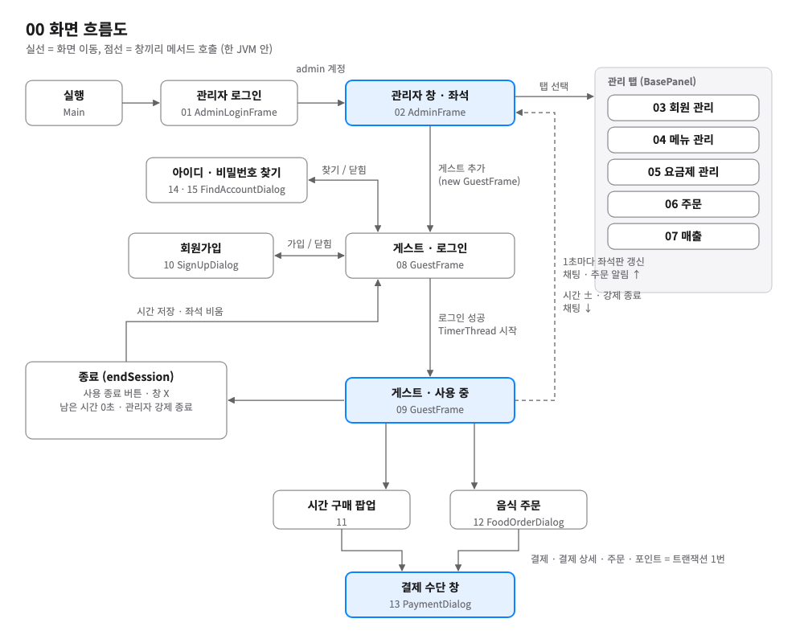

#### 관리자 화면

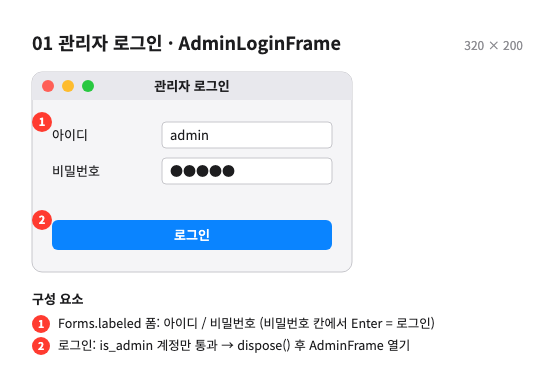

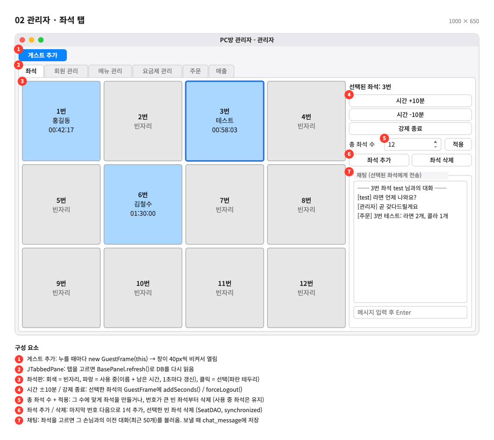

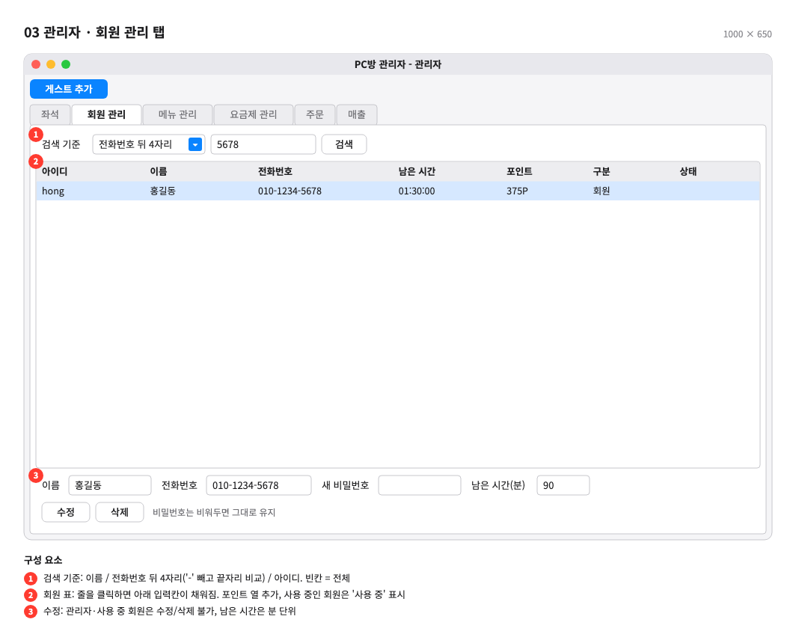

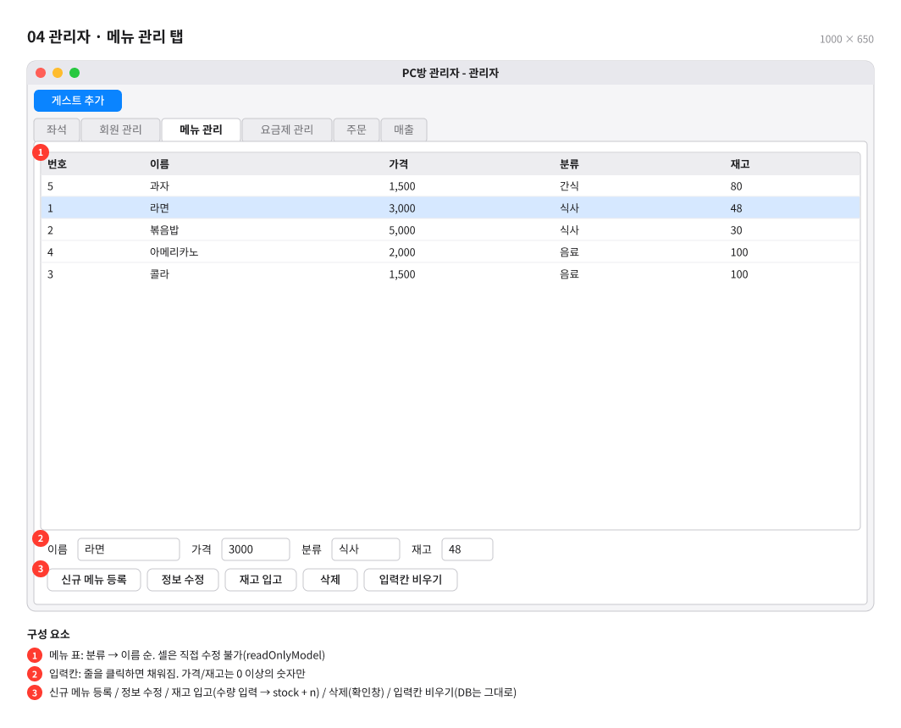

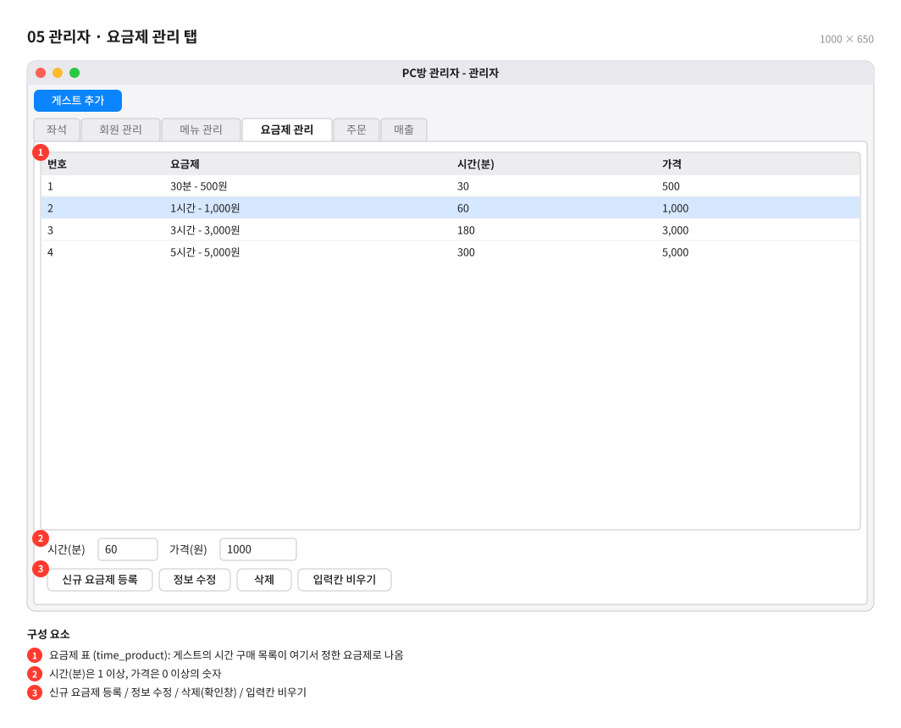

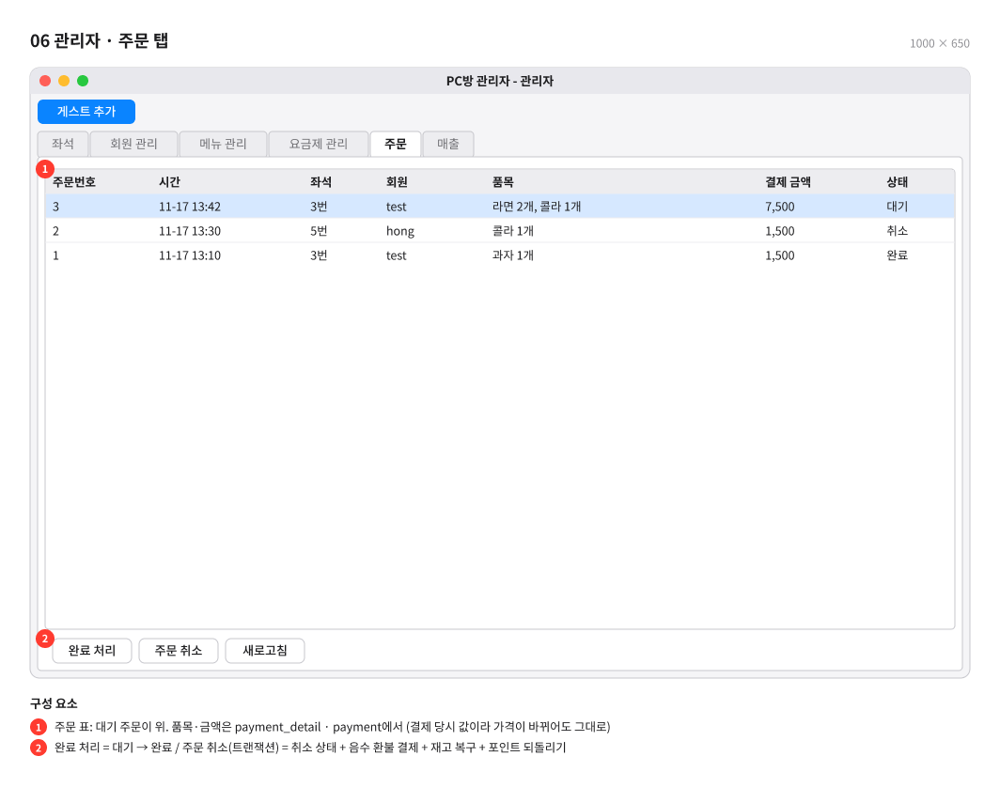

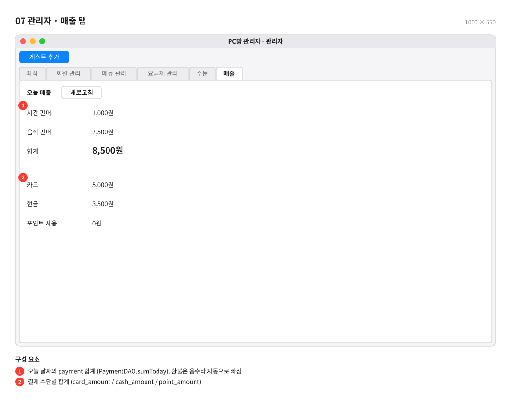

#### 게스트 화면

<p>
  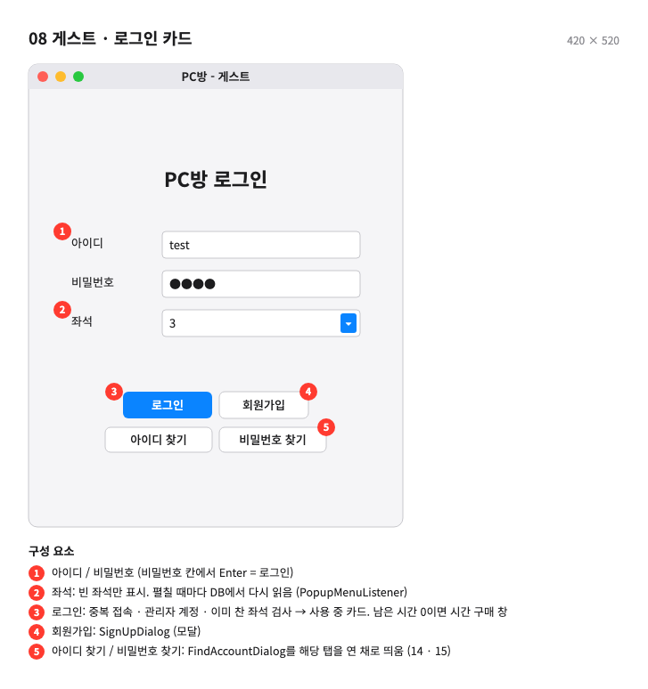
  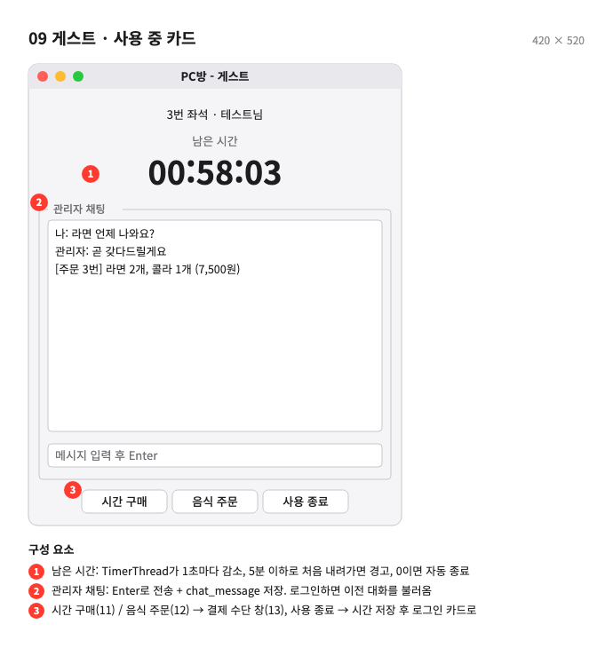
</p>

#### 팝업

<p>
  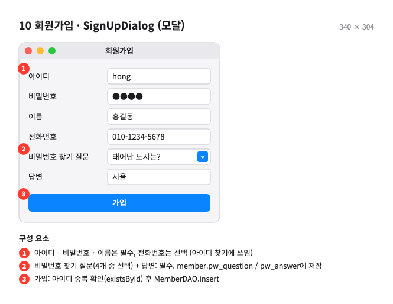
  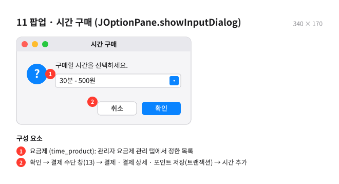
</p>
<p>
  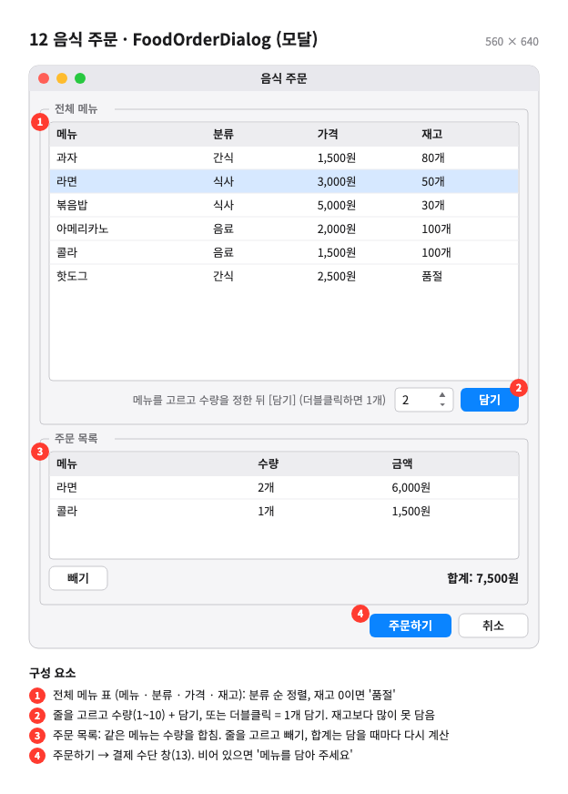
  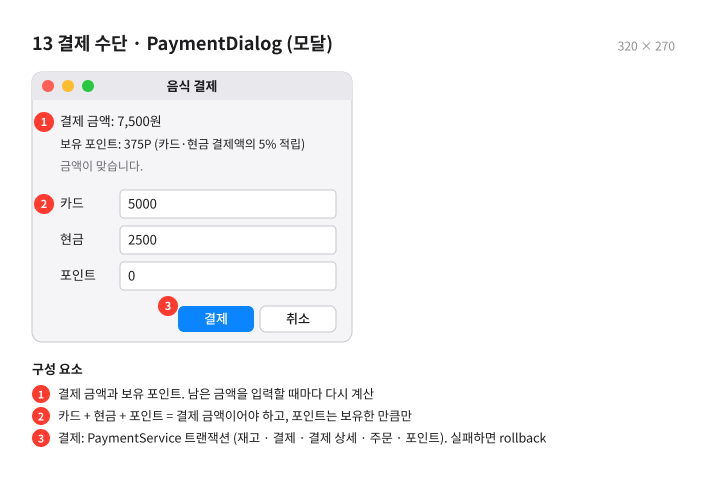
</p>

<p>
  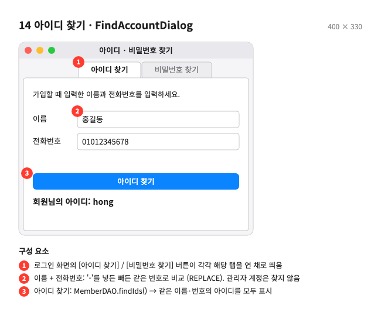
  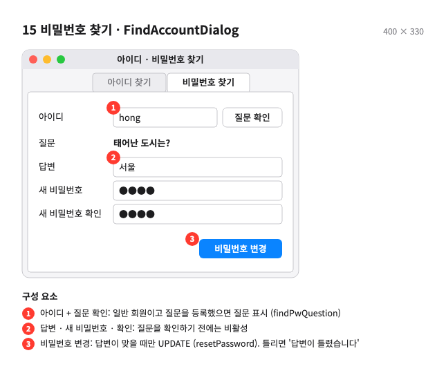
</p>

## 8. 실행 방법

1. MySQL 실행 후 스키마 생성: `mysql -u root -p < sql/schema.sql`
   - 이미 쓰던 DB가 있으면 `schema.sql` 대신 백업 후 아직 적용하지 않은 마이그레이션만 순서대로 한 번씩 실행한다. (`schema.sql`은 테이블을 지우고 새로 만든다)
     ```bash
     mysqldump -u root -p pccafe > ~/pccafe_backup.sql
     mysql -u root -p pccafe < sql/migrate_v2.sql   # 결제 상세 · 포인트 · 채팅 저장
     mysql -u root -p pccafe < sql/migrate_v3.sql   # 비밀번호 찾기 질문 · 답변
     ```
2. `src/main/resources/db.properties.example`을 `db.properties`로 복사하고 계정 정보 입력
3. IntelliJ에서 `pom.xml`을 Maven 프로젝트로 열기 → `pccafe.Main` 실행
4. 관리자 로그인: `admin` / `admin` → 관리자 창에서 "게스트 추가"
5. 게스트 테스트 계정: `test` / `1234` (1시간 보유, 전화번호 `010-1234-5678`, 비밀번호 찾기 질문 "태어난 도시는?" 답변 `서울`)

## 9. 개발 순서

1. DB 스키마(`schema.sql`) 작성, `DBUtil` 연결 확인
2. `BaseFrame` / `AdminFrame` / `GuestFrame` 뼈대, 게스트 추가 버튼
3. 회원가입 / 로그인 (`MemberDAO`)
4. 좌석 선택 + `TimerThread`, 창 닫을 때 시간 저장
5. 관리자 좌석판, 시간 추가 / 차감, 강제 종료
6. 시간 추가 구매 (`time_product`, `payment`)
7. 채팅
8. 메뉴 관리 / 음식 주문
9. 회원 관리 CRUD, 매출 확인, 경고 팝업 등 마무리
